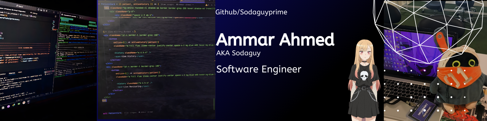
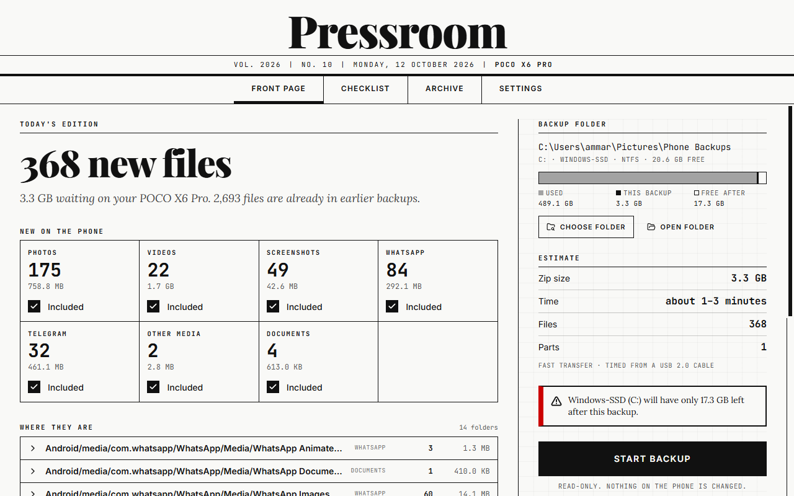
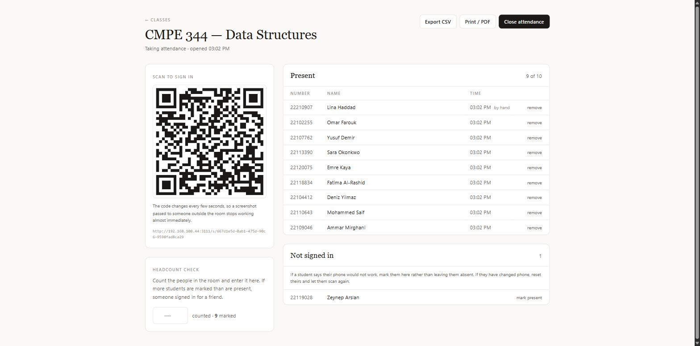

<h1 align="center">Hi 👋, I'm Ammar</h1>
<h3 align="center">A passionate Software developer</h3>

  

  
  

  

📫 Contact me on **ammarisahmed@gmail.com** or through my LinkedIn above :D

⚡ Fun fact about me: <strong>i love cola :3</strong>

🎓 BSC in Software Engineering and Still Learning(and probably forever)

<h3 align="left">Experience:</h3>

| Role | Company | Date |
|---|---|---|
| 💼 Frontend Development — Practicum Program | Mayerfeld | Apr 2026 |
| 💼 Front-End React Intern | Elevvo | Feb – Mar 2026 |
| 💼 Software Engineering Virtual Experience | Electronic Arts | Jan 2026 |
| 💼 Full Stack and IoT Engineer Intern | Near East University IoT R&D Centre | Jun – Aug 2025 |

<h3 align="left">Projects:</h3>
<table>
  <tr>
    <td width="50%" valign="top">
      
      <h4><a href="https://github.com/Sodaguyprime/privenator">Privenator</a></h4>
      A private, offline voice journal. Speak, and it's transcribed and encrypted on your own computer. 
      Rust · Tauri · TypeScript
    </td>
    <td width="50%" valign="top">
      
      <h4><a href="https://github.com/Sodaguyprime/pressroom">Pressroom</a></h4>
      Plug in your Android phone, press one button, and get a zip of every photo and video that's new since last time. 
      Rust · Tauri · React
    </td>
  </tr>
  <tr>
    <td width="50%" valign="top">
      
      <h4><a href="https://github.com/Sodaguyprime/watch-together">Watchu Pati</a></h4>
      Watch movies, play games and chat together with friends. 
      TypeScript
    </td>
    <td width="50%" valign="top">
      
      <h4><a href="https://github.com/Sodaguyprime/Teachers_student-attendance">Student Attendance System</a></h4>
      Students sign in by scanning a QR code that changes every few seconds, so a screenshot sent outside the room stops working. 
      TypeScript
    </td>
  </tr>
</table>

<h3 align="left">Certifications:</h3>

| | Certificate | Issuer | Date |
|---|---|---|---|
| ⚛️ | Modern React from The Beginning | Udemy | Aug 2025 |
| 🤖 | Solace Certified Agent Mesh Practitioner | Solace | Dec 2025 |
| 🍃 | MongoDB CRUD Operations | MongoDB | Oct 2025 |
| 🍃 | MongoDB: From Relational Model to Document Model | MongoDB | Oct 2025 |
| 🤖 | GitHub Copilot Prompt Engineering | GitHub | Oct 2025 |

Show all certifications

| | Certificate | Issuer | Date |
|---|---|---|---|
| 🍃 | MongoDB Database Basics | MongoDB | Oct 2025 |
| 🤖 | Solace Agent Mesh Foundations | Solace | Dec 2025 |
| 🤖 | GitHub Copilot: Code Smarter | GitHub | Oct 2025 |
| 🤖 | Enhanced Development with GitHub Copilot Integration | GitHub | Oct 2025 |
| 🤖 | Transform Your Code: GitHub Copilot Magic | GitHub | Oct 2025 |
| 🏆 | CIU Hackathon 2025 — Participation | Cyprus International University | May 2025 |
| 🎓 | Engineering Honour List | Cyprus International University | Jun 2024 |

See the full certificates on my <a href="https://ammarahmed-portfolio.vercel.app">portfolio</a>.

